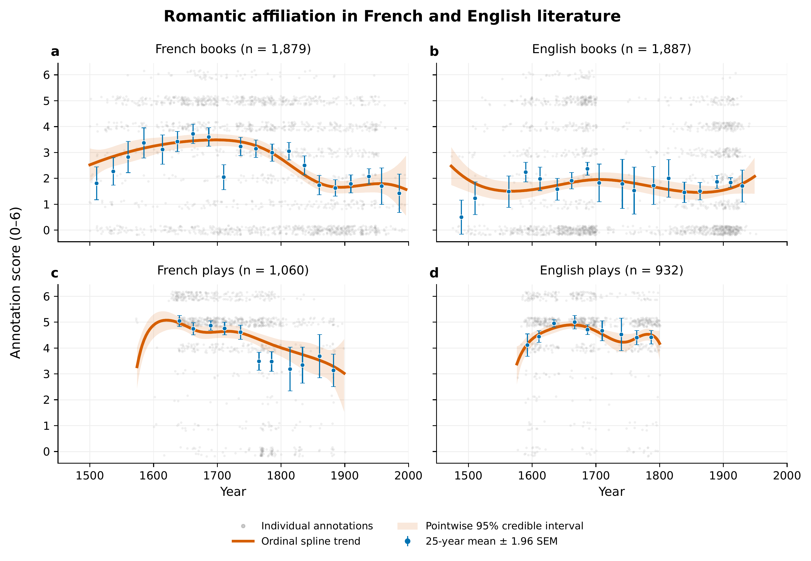

# The rise and fall of romantic love in French and English literature, 1473–1996

Research code, frozen annotations and results for the article by Sylvain Estebe, Edgar Dubourg, Ze Fu and Nicolas Baumard.

**Current analysis: ordinal cubic splines, November 2026.** Each corpus has an author random-intercept model. The displayed spline is selected by highest leave-one-out ELPD among df = 4, 5 and 6; the robustness analysis also compares linear, quadratic and df = 3 specifications. Earlier quadratic results remain available and are labelled below.

[Figures](results/figures/README.md) · [Numerical results](results/README.md) · [Spline reproduction](docs/SPLINES.md) · [Data](data/README.md) · [Annotation and prompts](docs/ANNOTATION.md)



## Start here

```sh
uv sync --locked
make spline-figures
```

This redraws the main affiliation figure, text signalling, Babel affiliation/signalling and shape-robustness figure from the committed numerical summaries. It does not fit models, call an API, require R or download posterior files. `make reproduce` runs the same safe figure workflow.

```sh
make test                 # Offline regression tests
make submission-figures   # Rebuild all eight submission PDFs/PNGs; also requires pdftoppm (Poppler)
```

The finished [PDFs](results/figures/PDF) and [300-dpi PNGs](results/figures/PNG_300dpi) are already included. See [reproduction commands](docs/SPLINES.md) for posterior verification, table regeneration and explicit model fitting.

## Find what you need

| Content | Location |
| :--- | :--- |
| Main figure and supplementary Figures S1–S7 | [Figure gallery and index](results/figures/README.md) |
| Spline model comparison, curves, diagnostics and timing estimates | [Spline results](results/splines/README.md) |
| Table S10: robustness to time-trend specification | [Readable table](results/splines/robustness/Table_S10.md) · [CSV](results/splines/robustness/Table_S10.csv) |
| Century contrasts and steepest decline | [Contrasts](results/splines/contrasts) |
| Length-adjusted spline sensitivity | [Numerical results](results/splines/robustness/Length_sensitivity.csv) |
| Analysis-ready data | `analysis_data.csv` in each [affiliation](results/splines/affiliation), [English Babel affiliation](results/splines/affiliation_babel) and [signalling](results/splines/signalling) corpus directory |
| Raw texts, annotations, manual validation and metadata | [Data guide](data/README.md) |
| Annotation scripts and prompts | [Annotation guide](docs/ANNOTATION.md) · [Prompts](prompts) |
| Current analysis and figure code | [analysis/splines](analysis/splines) |
| Earlier quadratic, two-lines, validation and decomposition analyses | [Results guide](results/README.md) · [Historical reproduction](docs/REPRODUCIBILITY.md) |

## Saved posterior draws

Large binaries are in [release v0.2.0](https://github.com/SylvainEstebe/the-rise-and-fall-of-romantic-love-in-french-and-english-literature-1473-1996/releases/tag/v0.2.0), outside ordinary Git storage. The repository contains the numerical tables, diagnostics, figures and checksums.

```sh
# Predictive draws (~2.45 GB): check curves and recompute contrasts
uv run --locked python script/restore_splines.py --kind draws
make spline-verify
make spline-contrasts

# Full posterior checkpoints (~14.7 GB): regenerate Table S10 from fitted models
uv run --locked python script/restore_splines.py --kind models
make spline-publication
```

The downloader verifies SHA-256 hashes and preserves matching files. Archive downloads and extracted files both use disk space. The earlier 44-model archive set remains in [release v0.1.0](https://github.com/SylvainEstebe/the-rise-and-fall-of-romantic-love-in-french-and-english-literature-1473-1996/releases/tag/v0.1.0).

## Corpora

| Corpus | Romantic affiliation observations |
| :--- | ---: |
| French books (Roland) | 1,879 |
| English books (EarlyPrint–Gutenberg) | 1,887 |
| French theatre | 1,060 |
| English theatre | 932 |
| French Babel | 1,870 |
| English Babel | 826 |

Babel uses knowledge-based ratings elicited from bibliographic metadata; the four primary corpora use text annotations. See the data guide for input units and construct-specific coverage.

## Reuse and citation

[MIT](LICENSE) covers the code. Source-text rights and data provenance are described in [data/README.md](data/README.md). Annotation requests require your own provider credentials; copying `.env.example` is optional and is only needed for new annotation runs.

Use [CITATION.cff](CITATION.cff) to cite this repository. A small, standard-library example is available at [examples/summarize_scores.py](examples/summarize_scores.py).

The repository is currently private. Automatic archive downloads require a `GH_TOKEN` or `GITHUB_TOKEN` environment variable with read access. Alternatively, download the ZIPs from the release while signed in and pass their folder with `--archives`; no token is then needed by the restoration script.
