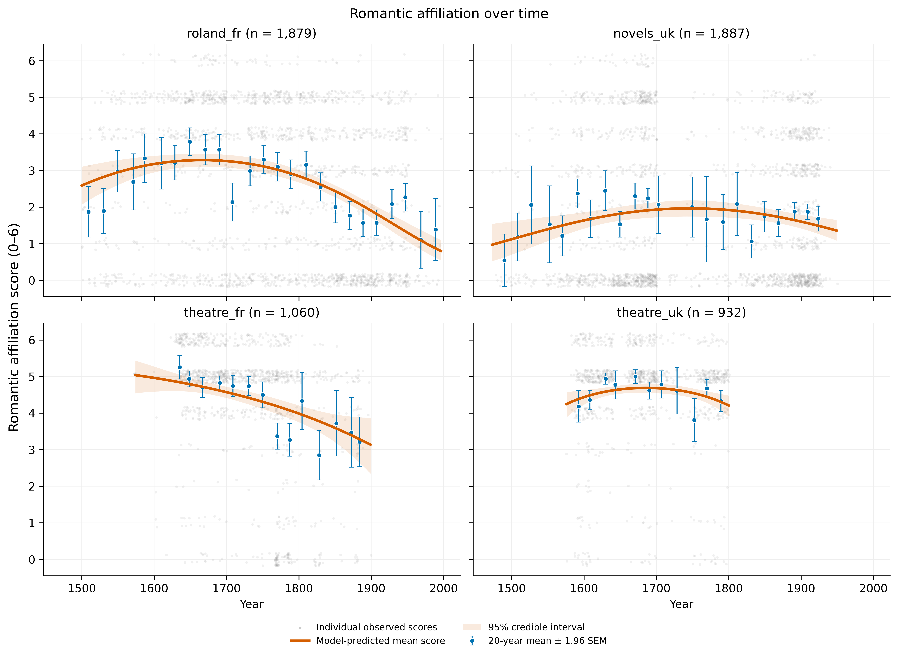

# Romantic love in French and English literature

**A reproducible study of romantic courtship across five centuries of books and plays (1473–1996).**

This repository contains the annotation inputs, frozen model ratings, human-validation materials, analysis code, and results supporting *The Rise and Fall of Romantic Love in French and English Literature, 1473–1996* by Sylvain Estebe, Edgar Dubourg, Ze Fu, and Nicolas Baumard.

The primary outcome is the **narrative importance of romantic affiliation**: attraction to and pursuit of a new romantic partner. Scores range from 0 (absent) to 6 (defining). Romantic signalling is a complementary outcome. These measurements concern literary representations, not the prevalence of love in historical populations.

[Get started](#get-started) · [Data guide](data/README.md) · [Reproduction guide](docs/REPRODUCIBILITY.md) · [Reuse the annotation tools](docs/ANNOTATION.md) · [Find a result](results/README.md)

## What is included?

| Corpus | Input scored | Records | Years |
| :--- | :--- | ---: | :--- |
| French books — Roland | Sampled passages | 1,879 | 1500–1996 |
| English books — EarlyPrint–Gutenberg | Sampled passages | 1,887 | 1473–1949 |
| French theatre | Complete available texts | 1,060 | 1574–1899 |
| English theatre | Complete available texts | 932 | 1576–1800 |
| **Primary total** | | **5,758** | **1473–1996** |

Supplementary Babel ratings use bibliographic information and model knowledge, without supplying the literary text. Valid romantic-affiliation samples contain 1,870 French and 826 English records; coverage differs for other constructs. They are a separate measurement source.



*Main study figure. Books are represented by sampled passages; plays by complete available texts. See the [results guide](results/README.md) for numerical outputs and downloadable figures.*

## Get started

### 1. Explore a small example

With Python 3.11 installed, run from the repository root:

```sh
python3 examples/summarize_scores.py
```

This uses only the Python standard library. It reads the frozen French annotations and writes `results/examples/summary.csv`; no API key, R, or model fitting is needed. Expected output: **1,879 observed scores**, a mean of approximately **2.6525**, and a positive-score proportion of approximately **0.6977**.

### 2. Install the analysis environment

Install [uv](https://docs.astral.sh/uv/getting-started/installation/), Python 3.11, and [R](https://cran.r-project.org/). Then:

```sh
make setup
make check
make test
```

`make setup` installs the exact Python versions in `uv.lock` and the R packages listed in `requirements.R`. Initial setup needs an internet connection. The integrity check verifies the primary text hashes, analytical sample sizes, and selected validation values. The small test suite checks the reusable example and custom annotation constructs.

### 3. Reproduce the study

Saved posterior draws are distributed separately in the [v0.1.0 release](https://github.com/SylvainEstebe/the-rise-and-fall-of-romantic-love-in-french-and-english-literature-1473-1996/releases/tag/v0.1.0). Download all eight `romantic-love-models-*.zip` files into one directory, then restore and verify them:

```sh
python3 script/restore_models.py --archives /path/to/downloads
```

This restores 44 model files to their original `results/` paths and checks their SHA-256 hashes. The repository includes the code, text inputs, annotations, metadata, tables, and figures; it does not require Git LFS. If you prefer to estimate the models yourself, skip the downloads and run `make refit`.

```sh
make reproduce
```

This runs the analysis from frozen annotations, reusing saved posterior draws when present and fitting missing models. It generates numerical tables, PNG/PDF figures, and a step-by-step report. It does **not** make annotation API calls.

Use `make refit` to estimate every model again. **Always refit after changing analysis inputs or model specifications:** existing model files are not automatically checked against changed inputs. Full fitting is substantially more demanding than reading the saved results. See [requirements, commands, and limitations](docs/REPRODUCIBILITY.md).

## Repository map

```text
analysis/       Statistical analyses, figures, and manuscript exports
data/           Frozen scores, metadata, exact input texts, human validation
docs/           Reproduction, annotation, and release documentation
examples/       Small offline example using frozen scores
prompts/        Construct definitions and annotation prompt references
results/        Saved tables, figures, posterior draws, and run reports
script/         Command-line annotation drivers
src/annotation/ Shared annotation code
tests/          Small offline regression checks
huggingface/    Companion dataset-card source
```

Start with [the results guide](results/README.md) to find the main figure and manuscript tables. The [output index](results/article/tables.csv) maps current manuscript table labels to files; historical `table_s*.csv` filenames use an older numbering scheme.

## Use this project for a new study

- Reuse the frozen scores directly with the [example](examples/README.md).
- Define your own constructs and annotate text files using the [annotation guide](docs/ANNOTATION.md).
- Keep new annotations in a separate output directory. Preserve the original study inputs when adapting an analysis.
- Record the input files, prompts, provider/model identifier, settings, and repository commit for each new run.

The statistical scripts are study-specific: corpus identifiers, paths, and some expected counts are fixed. The annotation utilities and file formats are reusable, but this repository is not a general-purpose installed Python package.

## Provenance and limits

Human validation covers 40 French excerpts. Passage ratings, full-play ratings, and knowledge-based work ratings should not be treated as interchangeable. Corpus coverage is uneven, and a zero passage score does not establish that courtship is absent from the whole book. See the [data guide](data/README.md) for missingness, the historical human-rating correction, source attribution, and materials that were not retained.

The companion text dataset is listed at [Hugging Face](https://huggingface.co/datasets/SylvainEstebe/romantic_love_corpus). The [dataset card source](huggingface/README.md) documents its scope; the analysis uses the paths and hashes recorded in this repository.

## Citation and license

Use [CITATION.cff](CITATION.cff) to cite the research software, and include the commit used. The manuscript authors are Sylvain Estebe, Edgar Dubourg, Ze Fu, and Nicolas Baumard. A publication DOI is not recorded here.

The code is distributed under the [MIT license](LICENSE). Source-text permissions and attribution are separate; no dataset-wide license is assigned to the literary texts by this repository. See [data provenance](data/README.md#sources-and-rights).

For corrections or reproducibility problems, open an issue with the command, error, environment, and commit. See [CONTRIBUTING.md](CONTRIBUTING.md).
