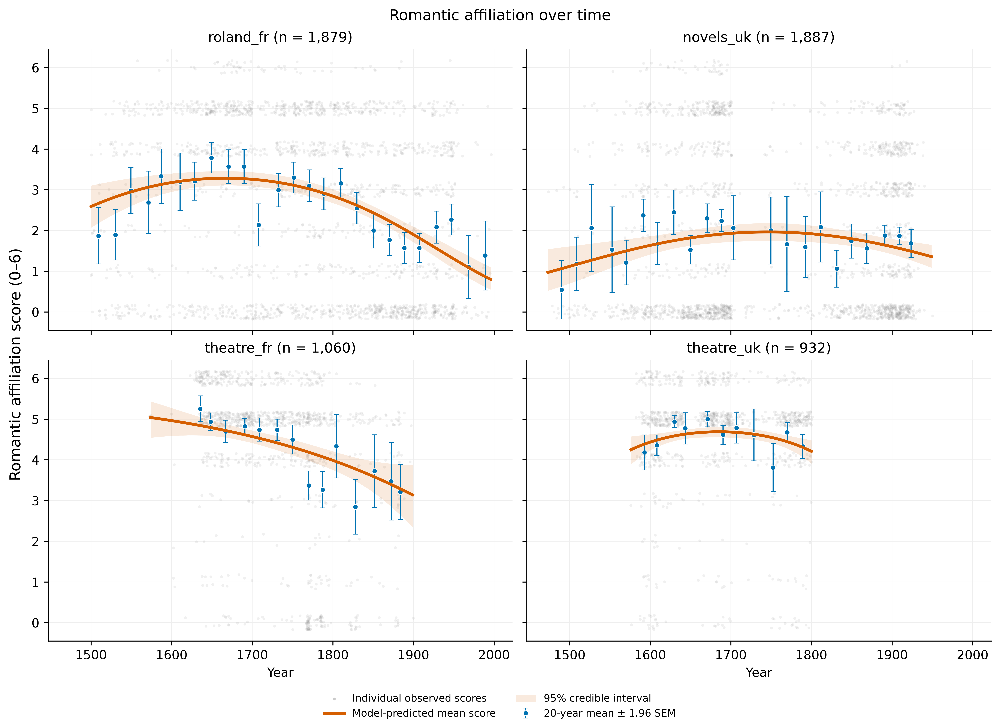

# Results guide

The [figure index](article/figures.csv) lists all main and supplementary figure files in PNG and PDF. The [table index](article/tables.csv) links current manuscript labels to their numerical files or definition sources. Paths inside these CSVs are relative to the repository root.

## Main results

The panels describe sampled French and English book passages and complete available French and English play texts. Differences in the input unit matter when comparing score levels.

| Result | File |
| :--- | :--- |
| Main figure, PDF | [figure_ordinal.pdf](primary/figures/figure_ordinal.pdf) |
| Corpus coverage | [table_1.csv](article/table_1.csv) |
| Primary model comparison and two-lines tests | [table_2.csv](article/table_2.csv) |
| Primary model coefficients | [primary_coefficients.csv](article/primary_coefficients.csv) |
| Descriptive statistics | [descriptive_statistics.csv](article/descriptive_statistics.csv) |
| Human validation | [human_validation.csv](article/human_validation.csv) |
| Author-group structure | [author_groups.csv](article/author_groups.csv) |
| Occurrence and conditional-importance contrasts | [century_contrasts.csv](article/century_contrasts.csv) |

## Analysis directories

| Directory | Contents | Generating command |
| :--- | :--- | :--- |
| `primary/` | Four-corpus ordinal fits, two-lines results, main figures | `make primary`, then `make twolines` |
| `signaling/` | Text-based romantic-signalling analyses | `make signaling` |
| `latent/` | Knowledge-based Babel analyses | `make latent` |
| `length/` | French source-length sensitivity | `make length` |
| `courtship/` | Observed decomposition and later-period models | `make descriptive`, then `make two-part` |
| `courtship/doc_assets/` | Supplementary S4–S6 PNG/PDF panels | Generated by `make two-part`; redraw with `make figures` |
| `validation/` | Agreement estimates and bootstrap intervals | `make validation` |
| `submission/` | Descriptive statistics, quadratic turning points, validation and two-lines exports | `make submission` |
| `article/` | Numerical table exports and table/figure indexes | `make tables` |

`make reproduce` executes the complete sequence. Individual export targets require upstream results to exist. Supplementary histogram S1 is generated by `analysis/histograms.py`, included in the full runner and `make figures`.

## Current versus historical table numbering

The legacy `article/table_s*.csv` files remain available for compatibility. Use the descriptive names or `tables.csv` for the current manuscript:

| Current manuscript | Descriptive file | Historical filename |
| :--- | :--- | :--- |
| S5 | `construct_coverage.csv` | `table_s4.csv` |
| S6 | `human_validation.csv` | `table_s5.csv` |
| S7 | `author_groups.csv` | `table_s6.csv` |
| S8 | `model_comparison.csv` | `table_s7.csv` |
| S9 | `century_contrasts.csv` | `table_s8.csv` |

The exports provide numerical source data, not the manuscript's typeset tables. S1, S3, and S4 also contain descriptive definitions; their index entries link to those sources rather than claiming to regenerate a formatted table.

## Posterior files and run reports

NetCDF (`.nc`) files retain posterior draws. They are the largest files in the project and support fast regeneration without resampling. Existing draws are not invalidated automatically when inputs change; use `make refit` after scientific changes.

The 44 NetCDF files are distributed as eight ZIP assets in the GitHub release linked from the main README. `model_manifest.csv` records each model's path, size, and SHA-256 hash; `model_archives.json` records archive sizes and hashes. `script/restore_models.py` restores downloaded archives and verifies their contents. Model binaries are intentionally excluded from ordinary Git storage.

`reproduction.json` records the most recent complete-run attempt. It includes elapsed times and exit statuses. New annotation runs and example output are excluded from Git by default.
