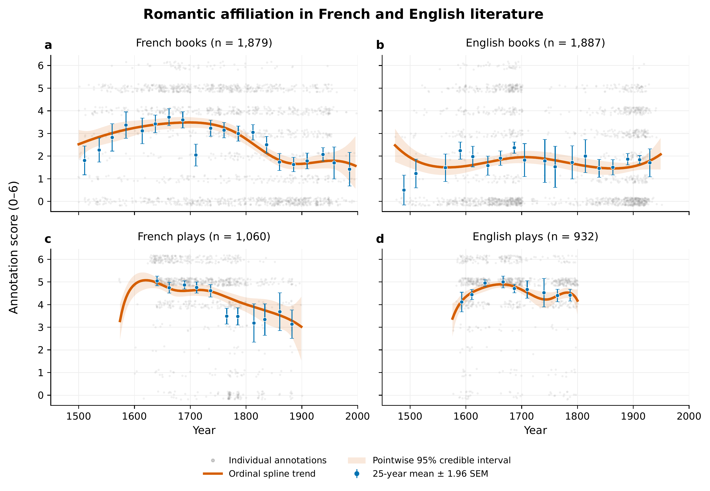
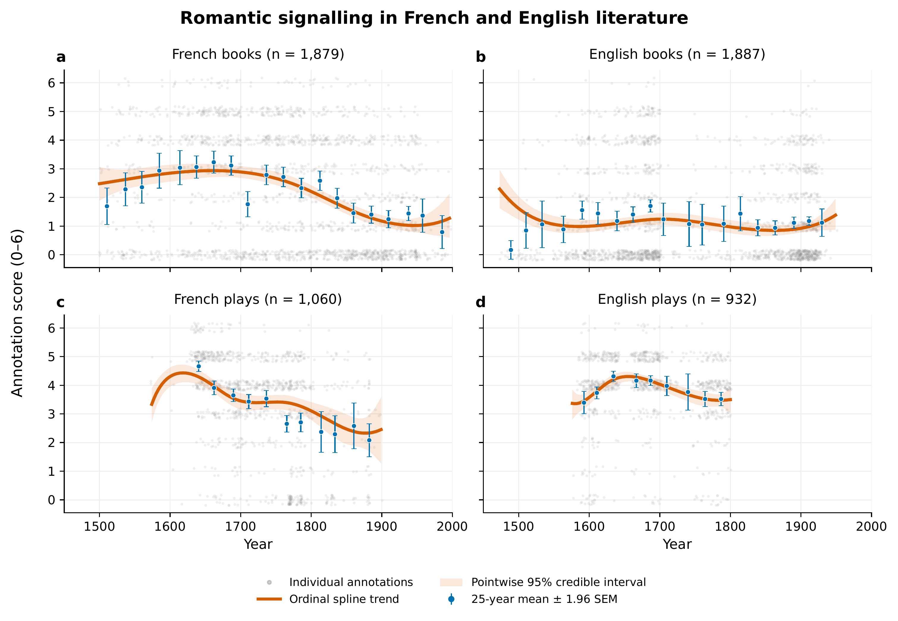
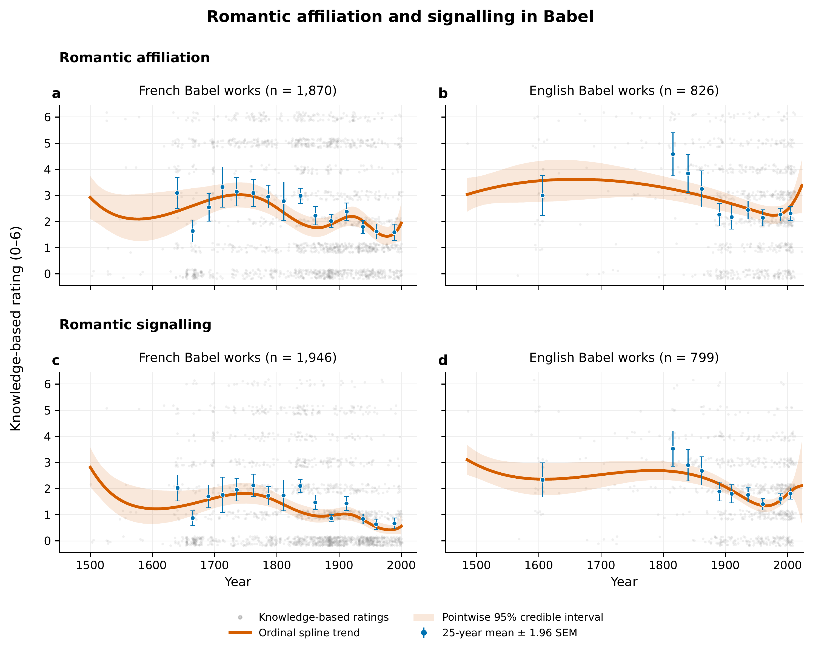
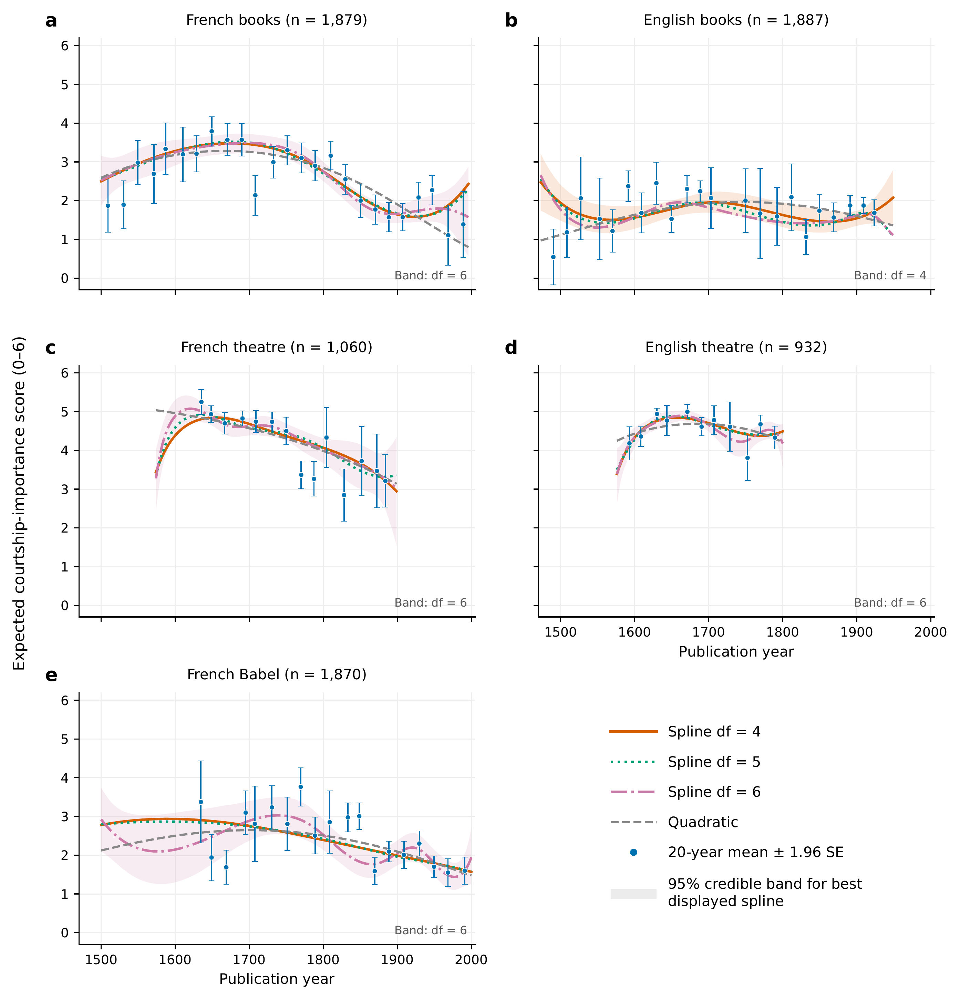

# Article figures

[Home](../../README.md) · [Numerical results](../splines/README.md) · [Reproduce](../../README.md#posterior-draws)

Eight figures, each supplied as a single-page PDF and a 300-dpi PNG.

| Figure | Content | Downloads |
| :--- | :--- | :--- |
| Figure 1 | Romantic affiliation — four primary corpora | [PDF](PDF/Figure_1.pdf) · [PNG](PNG_300dpi/Figure_1.png) · [Caption](../splines/figures/figure_1_spline_caption.md) |
| Figure S1 | Publication-year distributions | [PDF](PDF/Figure_S1.pdf) · [PNG](PNG_300dpi/Figure_S1.png) |
| Figure S2 | Romantic signalling — four primary corpora | [PDF](PDF/Figure_S2.pdf) · [PNG](PNG_300dpi/Figure_S2.png) · [Caption](../splines/figures/figure_romantic_signalling_spline_caption.md) |
| Figure S3 | Babel affiliation and signalling | [PDF](PDF/Figure_S3.pdf) · [PNG](PNG_300dpi/Figure_S3.png) · [Caption](../splines/figures/figure_babel_affiliation_signalling_spline_caption.md) |
| Figure S4 | Observed occurrence and conditional importance | [PDF](PDF/Figure_S4.pdf) · [PNG](PNG_300dpi/Figure_S4.png) |
| Figure S5 | Threshold sensitivity: scores ≥ 3 | [PDF](PDF/Figure_S5.pdf) · [PNG](PNG_300dpi/Figure_S5.png) |
| Figure S6 | Independent later-period models | [PDF](PDF/Figure_S6.pdf) · [PNG](PNG_300dpi/Figure_S6.png) |
| Figure S7 | Sensitivity to spline flexibility | [PDF](PDF/Figure_S7.pdf) · [PNG](PNG_300dpi/Figure_S7.png) · [Caption](../splines/robustness/Figure_S7_caption.md) |

## Main result

## Signalling and Babel

## Shape robustness

`validation.json` maps each submission figure to its source PDF and records page, resolution and checksum checks. S4–S6 combine the earlier French/English panels. Figure S1 uses 25-year bins without a dotted reference line; the manuscript caption should match this.
